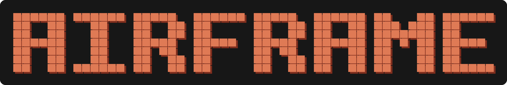

<p align="center">
  
</p>

<p align="center">
  <a href="https://github.com/Vin124/airframe/actions/workflows/ci.yml"></a>
  <a href="https://www.python.org/downloads/"></a>
  <a href="#requirements"></a>
  <a href="LICENSE"></a>
  <a href="#status"></a>
</p>

> ⚠️ **Work in progress.** This is an experimental debug harness, not a finished
> product. Core pieces work, but gesture detection (especially pinch-to-grab)
> is still being tuned and **may not work reliably yet** depending on your
> camera, lighting, and hand distance. Expect rough edges. See [Status](#status).

**Control your screen with your hands.** A real-time, gesture-driven overlay
studio for Windows: grab images, live windows, or your whole monitor with a
pinch, move and resize them mid-air, draw in the air, summon pictures with your
voice — and broadcast the whole composition to a virtual camera for any video
call.

<!-- TODO: record a short demo GIF (pinch-grab -> resize -> air-draw -> voice spawn) and embed it here:

-->

## Features

- **Real-time hand tracking** — MediaPipe `HandLandmarker` (Tasks API) with
  One-Euro landmark smoothing: rock-steady at rest, no drag lag in motion.
- **Scale-invariant pinch** — pinch detection is palm-relative, so the same
  finger gap triggers whether you're right at the camera or across the room.
  Live-tunable thresholds with hysteresis (no pinch/open flicker).
- **Grab, move, resize** — pinch a layer to grab it with either hand; pinch
  with both hands to resize. Stable two-hand slot matching keeps each hand's
  gesture state glued to the right hand.
- **Multi-layer scene** — overlay image files, **live application windows**, or
  **entire monitors** (Windows Graphics Capture); stack, raise, and remove
  layers at runtime.
- **Air-drawing** — toggle draw mode and use a pinch as the pen; strokes freeze
  into a grabbable layer.
- **Trash-corner remove** — drag a grabbed layer into the corner zone and
  release to delete it.
- **Voice commands** *(optional)* — always-on transcription (Moonshine /
  faster-whisper) → local-LLM parsing (Ollama) → image retrieval (Wikimedia
  Commons, DuckDuckGo fallback). Say *"put a picture of the Eiffel Tower on
  screen"* and pull the docked preview into the scene with a pinch.
- **GPU image generation** *(optional)* — "generate"-routed requests run
  SDXL-Turbo locally (8 GB VRAM target) and spawn the result like a retrieved
  image.
- **Virtual camera output** — broadcast the composited frame to any app that
  accepts a webcam (via OBS Virtual Camera).
- **Native-resolution capture** — opens your webcam at its maximum mode
  (e.g. 1080p30) while keeping tracking cost flat.
- **Control panel** — a small Tkinter panel for source picking, virtual-cam
  toggle, live pinch tuning, and an FPS readout; settings persist across runs.
- **Fully threaded pipeline** — capture, tracking, and speech each run on their
  own thread with lock-free latest-wins hand-offs; the render loop never blocks.

## Requirements

- **Windows 10/11** (window/monitor capture and the virtual camera are
  Windows-specific)
- **Python 3.11+**
- A webcam

Optional, feature by feature:

| Feature | Needs |
|---|---|
| Virtual camera (`--virtualcam` / `v`) | [OBS Studio 26+](https://obsproject.com/) (its Virtual Camera backend) |
| Speech (`--speech`) | a microphone + `pip install sounddevice faster-whisper useful-moonshine-onnx` |
| Voice → request parsing (`--parse`) | [Ollama](https://ollama.com) running locally with a small model pulled (e.g. `ollama pull qwen2.5:1.5b`) |
| Web-search retrieval fallback | `pip install ddgs` |
| Image generation (`--generate`) | an 8 GB+ CUDA GPU + the torch/diffusers stack (see `requirements.txt`) |

Everything optional degrades gracefully: missing dependencies print one notice
and the rest of the app keeps running.

## Quick start

```bash
git clone https://github.com/Vin124/airframe.git
cd airframe
python -m venv .venv
.venv\Scripts\activate
pip install -r requirements.txt

# Debug view: live 21-point hand skeleton over your webcam
python -m src.main --mode skeleton

# The fun one: pinch-to-grab image overlays
python -m src.main --mode image --image assets/test.png
```

The hand-tracking model (~8 MB) downloads automatically into `models/` on
first run.

More launch recipes:

```bash
# Overlay a live application window (title substring match)
python -m src.main --mode image --source window --window-title "Notepad"

# Overlay a whole monitor (1 = primary)
python -m src.main --mode image --source screen --monitor-index 1

# Hotkeys only, no control panel
python -m src.main --mode image --image assets/test.png --no-panel

# Voice pipeline: transcribe -> parse -> retrieve -> pinch-to-spawn
python -m src.main --mode image --image assets/test.png --speech --parse

# ...plus local GPU image generation for "imagine/generate" requests
python -m src.main --mode image --image assets/test.png --speech --parse --generate
```

## Controls

### Gestures

| Gesture | Action |
|---|---|
| Pinch (thumb + index) over a layer | Grab it; move while pinched |
| Pinch with **both** hands | Resize the grabbed layer |
| Drag a grabbed layer into the bottom-right corner, release | Delete it |
| Pinch the docked voice-preview and pull **down** | Spawn it as a layer |
| Pinch in draw mode | Draw a stroke (release lifts the pen) |

### Hotkeys

| Key | Action |
|---|---|
| `q` | Quit (saves panel settings) |
| `s` | Toggle skeleton overlay |
| `r` | Reset the selected layer's transform |
| `+` / `-` | Scale the selected layer |
| `v` | Toggle virtual camera |
| `a` / `w` / `m` | Add an image / window / screen layer |
| `x` | Remove the selected layer |
| `f` | Bring the selected layer to the front |
| `d` | Toggle draw mode |
| `c` | Clear in-progress strokes (draw mode) |
| `k` | Cycle pen color (draw mode) |
| `[` / `]` | Pen width down / up (draw mode) |

### Control panel

A small Tkinter panel opens alongside the preview (skip with `--no-panel`):
pick a source and add it as a layer, toggle the virtual camera, reset the
scene, retune pinch detection with two live sliders, and watch the FPS
readout. Last-used settings persist to `airframe_config.json` and pre-fill next
launch (**CLI flags > saved config > defaults**).

## How it works

```
                ┌────────────────────┐
                │  Capture thread    │  webcam read @ native res
                └─────────┬──────────┘
                          │  latest frame (atomic publish)
                ┌─────────▼──────────┐
                │  Tracking thread   │  MediaPipe landmarks → One-Euro
                │                    │  smoothing → pinch/gesture hysteresis
                └─────────┬──────────┘
                          │  TrackingResult (atomic publish)
┌───────────────┐   ┌─────▼──────────────────────────────┐
│ Speech thread │──▶│  Main loop (30 FPS)                │
│ (optional)    │   │  scene → compositor → HUD          │
│ mic → ASR →   │   │  ├─ preview window                 │
│ LLM parse →   │   │  └─ virtual camera (optional)      │
│ retrieve/gen  │   └────────────────────────────────────┘
└───────────────┘
```

Each thread is the **single owner** of its state; hand-offs are one atomic
reference publish, latest-wins — no locks anywhere. The main loop is the sole
writer of the scene, so gestures, hotkeys, and panel buttons can never race.

The failure policy everywhere is **degrade, never die**: a crashed tracker, a
missing mic, an unreachable Ollama server, or a failed download each print one
notice and the app keeps running.

Deeper reading in [`docs/`](docs/): the full [spec](docs/spec.md), the
[phased build plans](docs/plan.md) ([chunk 2](docs/plan-2.md),
[chunk 3](docs/plan-3.md)), and a detailed [build log](docs/progress.md).
Architecture notes for AI-assisted development live in [`CLAUDE.md`](CLAUDE.md).

## Configuration

- **Live pinch tuning** — the panel's ENTER/EXIT sliders adjust the
  palm-relative pinch ratio on the fly (defaults 0.30 / 0.45; exit is always
  kept above enter so the pinch label can't flicker).
- **MediaPipe confidences** — `--min-detection-confidence`,
  `--min-presence-confidence`, `--min-tracking-confidence` (startup-only).
- **GPU delegate** — `--gpu` requests MediaPipe's GPU delegate and falls back
  to CPU with a notice (the expected case on Windows Python wheels).
- **Smoothing** — retune `DEFAULT_MIN_CUTOFF` / `DEFAULT_BETA` in
  `src/smoothing.py` if tracking feels sticky or floaty.
- All persisted settings live in `airframe_config.json` (created on exit,
  git-ignored).

## Troubleshooting

| Symptom | Fix |
|---|---|
| `Could not open webcam` | Close other apps using the camera; check Windows camera privacy settings |
| Virtual cam toggle prints a notice | Install OBS Studio 26+ (its Virtual Camera is the backend) |
| `GPU delegate unavailable` | Expected on Windows — tracking continues on CPU |
| `[parser]` notices with `--parse` | Start Ollama (`ollama serve`) and pull a small model |
| First `--generate` is very slow | One-time model download + load; subsequent generates are seconds |
| Pinch feels too eager / too stiff | Drag the panel's ENTER slider down / up |

## Status

**Work in progress — expect this to be rough.** It's a personal debug harness
for exploring webcam hand-tracking, not a polished app.

- **Known issue:** pinch-to-grab can be unreliable. Detection depends heavily on
  lighting, camera quality, and how far your hand is from the lens. It's being
  actively tuned (looser thresholds, a forgiving grab margin, and a release
  grace that rides out brief tracking dropouts) but **may still not work well
  for you.**
- If grabbing misbehaves, open the control panel and adjust the **pinch ENTER /
  EXIT** sliders live; settings persist to `airframe_config.json`.
- Feedback and issues are welcome while this is being figured out.

## Development

```bash
pip install -r requirements.txt
python -m pytest -q        # 700+ unit tests, all headless (no webcam needed)
```

The project was built in reviewable phases (see
[`docs/plan.md`](docs/plan.md) and the [build log](docs/progress.md)); every
phase leaves the app runnable. Pure logic (gestures, smoothing, geometry,
config, parsing) is separated from I/O so nearly everything is unit-testable
without a camera, display, or network.

Contributions welcome — see [CONTRIBUTING.md](CONTRIBUTING.md).

## License

[MIT](LICENSE)

## Acknowledgments

- [MediaPipe](https://developers.google.com/mediapipe) — hand landmark model
- [One-Euro filter](https://gery.casiez.net/1euro/) (Casiez et al., CHI 2012) — landmark smoothing
- [Moonshine](https://github.com/moonshine-ai/moonshine) / [faster-whisper](https://github.com/SYSTRAN/faster-whisper) — speech recognition
- [Ollama](https://ollama.com) — local LLM request parsing
- [Wikimedia Commons](https://commons.wikimedia.org/) — image retrieval
- [SDXL-Turbo](https://huggingface.co/stabilityai/sdxl-turbo) via [🤗 diffusers](https://github.com/huggingface/diffusers) — image generation
- [pyvirtualcam](https://github.com/letmaik/pyvirtualcam) + OBS — virtual camera output
- [windows-capture](https://github.com/NiiightmareXD/windows-capture) — window/monitor capture
- Inspired by Shacam-style gesture camera tools
